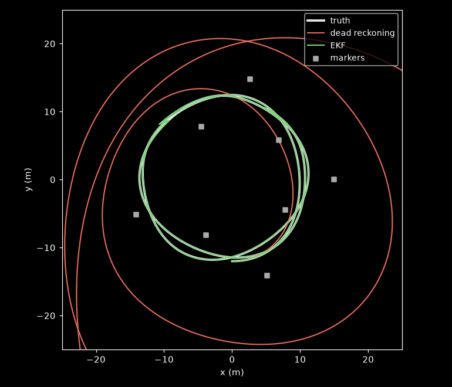

# rover-ekf-sim

A small simulation of the localization problem from my rover team: a rover
with an IMU and a stereo camera, and an extended Kalman filter that fuses
them. The team's code isn't mine to publish, so this rebuilds the core idea
somewhere the ground truth is known.



- **IMU**, 100 Hz: a gyro (yaw rate) and a forward accelerometer, both with
  noise and a constant bias. The gyro bias is 0.02 rad/s, about 1.1 deg/s.
- **Stereo camera**, 10 Hz: range and bearing to eight markers at known
  positions, within 15 m and 55 degrees either side of straight ahead. Range
  error grows with the square of distance, like real stereo depth.
- The rover drives about 2.4 laps of a wobbly 12 m loop in 180 s.

It compares four estimators: integrating the IMU alone, solving a pose from
each camera frame alone, an EKF over position, heading and speed, and the same
EKF with the gyro bias added to the state. It also runs the EKF once without
wrapping the bearing residual to [-pi, pi], to show what that does.

## Run

```
pip install numpy matplotlib
python ekf_sim.py images
```

Output (20 seeds, errors in meters, median over seeds):

```
                              median       RMS       max     final
dead reckoning                 27.71     37.27     80.77     80.77
camera only                     2.25      6.31     18.71      0.80
EKF, no bias state              1.68      2.80     10.18      1.75
EKF                             0.08      0.30      1.92      0.04
EKF, bearing not wrapped     1060.71   1490.45   2880.92   2880.92
```

The full output is in [results.txt](results.txt). I wrote up what's going on
in [Two Bad Sensors and a Kalman Filter](https://www.joelmr.com/blog/two-bad-sensors-and-a-kalman-filter/).

## License

MIT
